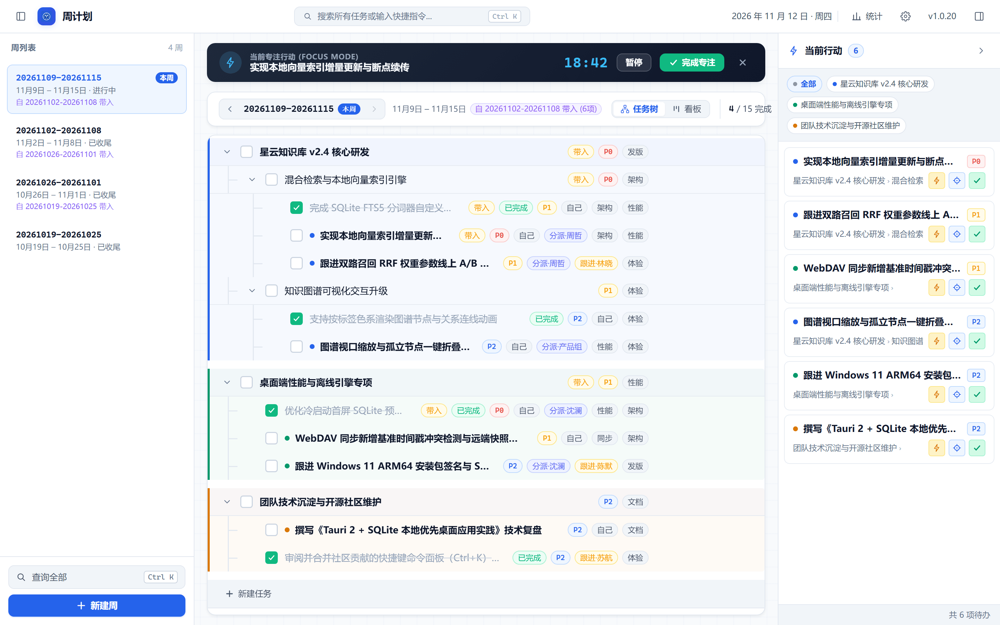
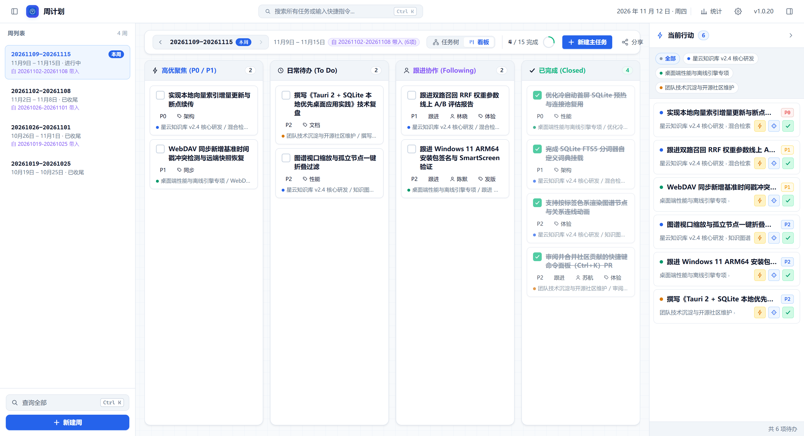
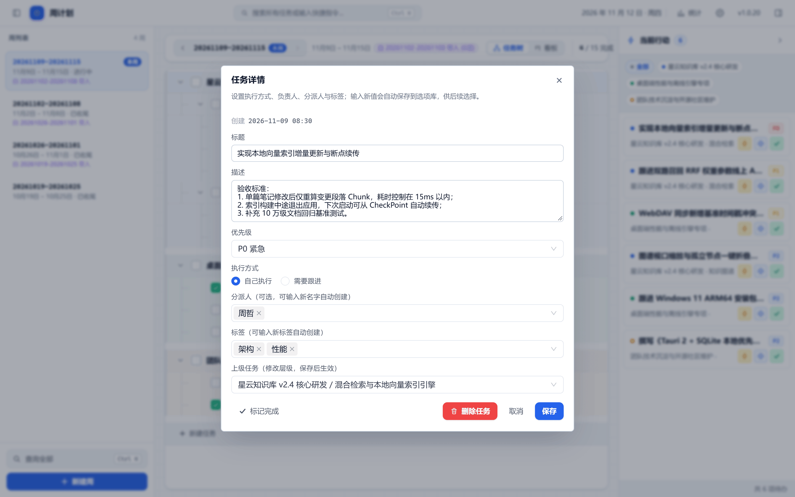
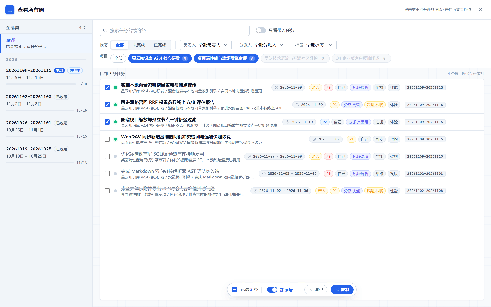
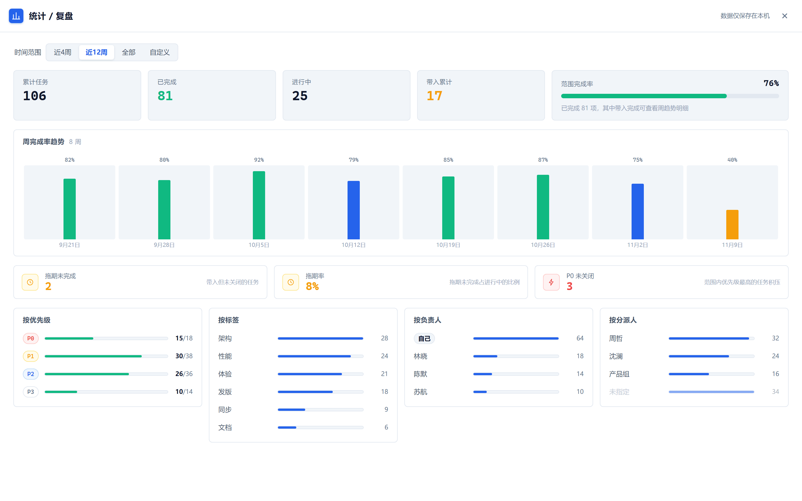
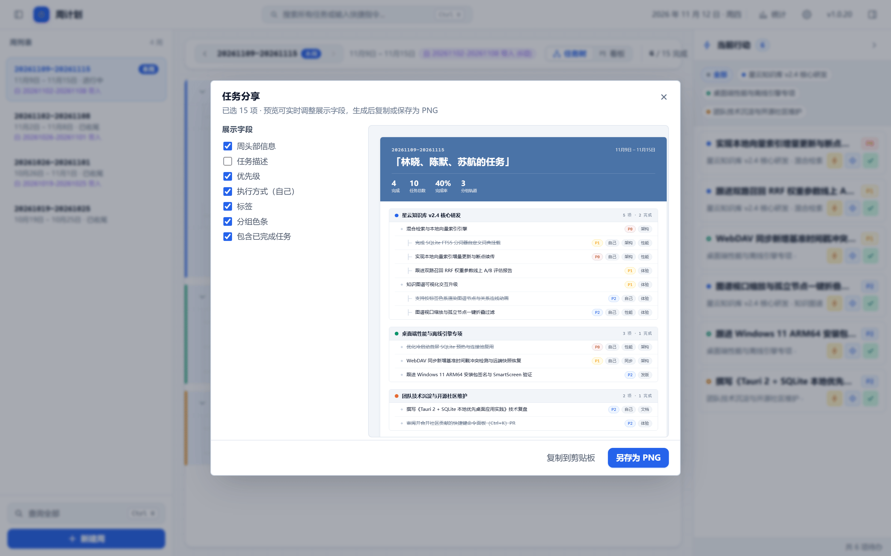
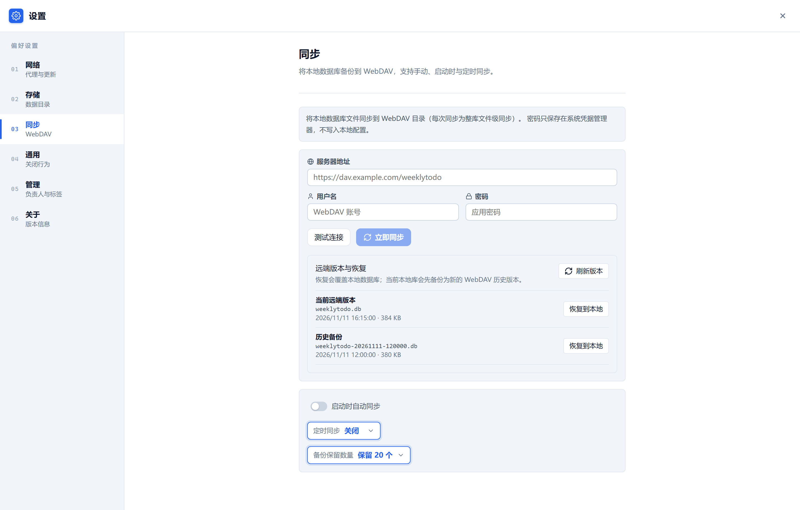

# 周计划（weeklytodo）

**以「周」为第一层级的本地优先 Windows 任务树与执行复盘桌面应用。**

告别传统待办列表「越积越长、做完与未做混杂、只见碎步不见项目全貌」的痛点——**周计划（weeklytodo）** 将自然周作为工作的天然节拍器：每周一自动开启新周期，上周未完成的任务树连同完整的父子层级上下文自动带入本周，已闭环分支自然沉淀归档；配合自动剥离父容器的「当前行动面板」、四列看板、番茄钟专注、跨周多维检索、周报长图分享与周期复盘统计，构建从**周初拆解 → 日常专注执行 → 周五汇报分享 → 周期数据复盘**的完整个人与团队效能闭环。

---

## 核心理念与产品特点

- **以「周」为第一公民的自动流转**：每周一自动创建新周（如 `20261109-20261115`），无需手动搬运任务。跨周未打开应用或应用在后台跨过周一 0 点时，均会自动从最近有效周无缝带入未完成任务。
- **「全局结构」与「当下行动」解耦**：左侧管理周期，中间用无限层级任务树拆解项目全貌，右侧自动提取所有可立即执行的**叶子任务**，既不迷失项目大局，也不被庞大树结构分散当下注意力。
- **个人深度执行 + 团队轻量跟进**：区分 `自己执行` 与 `需要跟进` 两种模式，支持 `P0–P3` 四级优先级、负责人（`@Owner`）、分派人（`← Assigner`）与多标签，一套工具同时覆盖个人事务与跨人协作跟进。
- **周报产出与复盘只在一瞬间**：多选任务即可一键渲染彩虹轨道式高清分享长图，或在全历史检索中勾选多条任务带编号批量复制；内置统计看板直接暴露「拖期率」与「P0 积压」。
- **100% 本地优先，数据主权归你**：全量数据保存在本机自选目录的单个 SQLite 文件中，启动极快、离线可用；可选开启带冲突保护与历史快照回滚的 WebDAV 同步。

---

## 亮点功能与界面预览

### 1. 三栏高效工作台与智能跨周带入



- **智能跨周流转规则**：每周一创建新周期时，上周未完成的分支按原父-子结构完整带入本周，并自动打上 `带入` 标识与来源周提示；若未完成子任务的父节点在上周已关闭，该父节点会作为只读上下文保留，确保子任务不沦为「无头孤儿」；已完全闭环的分支则不再带入，保持新周清爽。
- **彩虹分组轨道（Rainbow Track）**：顶层主任务（项目）自动分配高辨识度专属色系，左边框色条与子节点圆点贯穿整棵子树，多项目并行时视觉边界一目了然（支持在设置中自定义或重置颜色）。
- **当前行动面板（右侧栏）**：自动过滤掉充当容器的父节点，仅提取本周所有未完成的**叶子任务**，按 `P0 → P3` 优先级稳定排序。顶部支持按顶层项目色卡 Chip 一键筛选；每张行动卡可**一键定位**回左侧任务树（自动展开祖先节点并闪烁高亮）、**一键开启专注**或直接勾选完成。
- **番茄钟专注横幅（Focus Mode）**：点击任意行动的闪电按钮，工作区顶部即刻展开 25 分钟倒计时专注横幅，支持暂停/继续与一键完成撒花庆祝，帮助你进入心流状态。
- **全局命令面板（`Ctrl + K`）**：随时按下 `Ctrl + K` 唤醒全局搜索与快捷指令面板，实时检索全库历史任务并一键跳转定位，或快速执行新建任务、打开统计复盘、新建周等高频操作。

---

### 2. 树形拆解与四列看板双视图无缝切换



- **任务树视图（Tree View）**：面向项目拆解与层级梳理。支持一键过滤「仅看未完成」（保留未完成子任务的已完成父级骨架），已完成任务底部仍可继续追加新子任务。
- **看板视图（Kanban View）**：面向日常推进与站会核对。系统自动提取本周所有叶子执行项，按状态与属性智能聚合为四列：
  - **高优聚焦 (`P0 / P1`)**：优先攻克的紧急核心事项；
  - **日常待办 (`To Do`)**：常规推进的自我执行项；
  - **跟进协作 (`Following`)**：委派他人、需定期询问进展的跟进事项；
  - **已完成 (`Closed`)**：本周已闭环交付的成果，卡片底部自动附带所属项目色点与完整父级面包屑路径。

---

### 3. 无限层级拖拽与丰富元数据编辑



- **自由拖拽重排与调级**：支持 HTML5 原生行级拖拽，可将任务拖至目标行的上方、下方或直接拖入其内部成为子任务，实时呈现清晰的插入指示线。
- **多维协作元数据**：双击任意任务即可打开详情面板，配置：
  - **标题与多行描述**：记录任务背景、上下文链接与验收标准；
  - **四级优先级**：`P0 紧急`、`P1 高`、`P2 普通`、`P3 低`；
  - **执行方式切换**：`自己执行` 或 `需要跟进`（跟进模式下可指定具体**负责人**）；
  - **分派人与标签**：支持记录任务来源（分派人）与多维标签；输入新名字或新标签回车即可自动沉淀至本地选项库，后续下拉即选；
  - **可视化修改上级任务**：无需长距离拖拽，直接在下拉框中选择任意目标父节点即可跨分支迁移层级。

---

### 4. 跨周全历史多维检索与批量复制



- **多维组合精准过滤**：左侧导航栏默认仅展示最近 4 周以保持日常界面聚焦；点击「查询全部」即可跨所有历史周检索叶子任务。支持：
  - **关键词防抖搜索**（匹配任务名或完整路径）；
  - **顶层项目（分组）多选 Chip 过滤**：跨周同名项目自动合并计数，支持同时勾选多个项目对比查看；
  - **多条件交叉筛选**：按指定周（附带当周完成度进度条）、完成状态（全部 / 未完成 / 已完成）、`只看带入任务`、负责人、分派人、标签自由组合。
- **批量勾选与一键编号复制**：勾选多条查询结果后，底部自动浮现批量操作栏，支持开关**「加编号」**（自动生成 `1. 2. 3.` 有序列表）并一键复制任务标题到剪贴板，写周报、发会议纪要无需逐条手敲。
- **行内快捷管理**：查询结果行内支持直接重命名、双击调起跨周任务详情编辑，以及带子树节点数量提示的二次确认删除。

---

### 5. 全周期数据统计与复盘看板



- **灵活时间窗口**：支持按 `近 4 周`、`近 12 周`、`全部` 或 `自定义起止周区间` 聚合复盘数据。
- **核心交付总览与周完成率趋势**：直观展示区间内的累计任务数、已完成、进行中、带入累计与整体完成率进度条；柱状图按周呈现完成率走势，并按完成度高低自动分色（绿 / 蓝 / 橙）。
- **复盘风险直击卡**：专门提炼**「拖期未完成」**（跨周带入但仍未关闭的任务数）、**「拖期率」**（拖期任务占当前进行中任务的比例）与**「P0 未关闭积压」**三大预警指标，让复盘不再流于形式。
- **四维投入分布透视**：按**优先级完成比**、**标签分布**、**负责人分布**（自动置顶高亮「自己」执行的任务占比）与**分派人分布**生成归一化横向条形图，清晰洞察精力投向。

---

### 6. 一键生成彩虹轨道周报分享长图



- **智能连带多选**：在主界面点击「分享」进入多选模式，勾选父任务会自动连带选中其下所有未完成子树，也支持一键「全选可见」。
- **所见即所得的卡片定制**：内置高颜值彩虹轨道分享模板，左侧可实时勾选控制展示字段（周头部信息、任务描述、优先级、执行方式、标签、分组色条、是否包含已完成任务）。
- **精准叶子口径统计**：分享卡片头部的「完成 / 任务总数 / 完成率」与各轨道计数**仅统计实际执行的叶子任务**，剔除父级分组容器干扰，数据真实客观。
- **双通道导出**：支持**一键复制到系统剪贴板**（可直接粘贴至飞书、企业微信、钉钉或微信对话框）或通过系统对话框**另存为高清 PNG 图片**。

---

### 7. 本地优先存储、WebDAV 同步与历史快照恢复



- **自选目录与无损迁移**：首次运行可指定数据存放目录，随时可在「设置 → 存储」中一键迁移至新目录（迁移前自动备份原数据库并保留原文件）或直接在资源管理器中定位数据库文件。
- **WebDAV 安全同步与防冲突机制**：
  - **系统凭据加密**：WebDAV 密码仅保存在 Windows 系统凭据管理器（Credential Manager）中，绝不明文落盘到本地配置文件；
  - **灵活同步策略**：支持手动立即同步、应用启动时自动同步、以及按小时（1~24 小时）定时后台同步；
  - **基准时间戳（Baseline Mtime）与空库保护**：自动追踪本地与远端基准修改时间，防止新设备空数据库意外覆盖远端有数据的主库；
  - **远端多版本快照与一键恢复**：可配置远端备份保留数量（如保留 10 个、20 个或无限制），直接在面板中浏览远端当前库与历史时间戳备份列表，支持一键回滚恢复（恢复前自动将本地库备份至远端，并暂停自动同步以防误覆盖）。
- **集中式元数据与桌面体验配置**：支持统一增删改负责人、分派人、标签与项目配色；支持自定义点击关闭按钮（`×`）时的行为（每次询问 / 最小化到系统托盘后台常驻 / 直接退出）以及 GitHub Release 更新检查的网络代理配置。

---

## 技术栈

- **前端**：React 19 + TypeScript + Zustand 5 + Rsbuild + Ant Design 6 + Lucide Icons
- **桌面运行时**：Tauri 2（Rust）— 安装包轻量、冷启动极快、后台常驻内存占用低
- **数据存储**：SQLite（`rusqlite` + `bundled`）— 零外部依赖、单文件持久化、WAL 并发读写模式
- **安全与网络**：Windows Credential Manager（系统凭据库）+ Reqwest（支持系统代理 / 自定义代理、WebDAV 同步与 GitHub Release 语义化版本自动更新）
- **安装包构建**：NSIS 当前用户安装器，原生支持 Windows 10 / 11

---

## 开发指南

```bash
# 安装依赖
npm install

# 启动 Tauri 桌面端开发环境
npm run tauri:dev
```

## 质量检查与测试

```bash
# 前端 TypeScript 类型检查
npm run lint

# 运行前端组件与状态单元测试（Vitest + Testing Library）
npm test

# 运行 Rust 后端单元测试（周计算、跨周带入、数据迁移、WebDAV 同步与查询统计等）
cd src-tauri && cargo test
```

## 打包与发布

```bash
# 生成 Windows NSIS 安装器
npm run tauri:build
```

打 `v*` 标签推送到 GitHub 后，[release.yml](.github/workflows/release.yml) 会自动构建并把安装器发布到 GitHub Release；应用内「检查更新」会从最新 Release 获取安装包并在应用退出后自动拉起安装器完成无感升级。

### 预热 Rust 编译缓存（可选，推荐发版前执行）

GitHub Actions 的缓存按分支 / 标签隔离：Release 工作流由 `v*` 标签触发，只能读取该标签和默认分支（`main`）上的缓存。为了让发版时跳过 Rust 依赖的全量编译（约 7 分钟），发版前先在 `main` 上预热一次：

```bash
gh workflow run warm-cache.yml
```

首次执行是全量编译（约 8 分钟，一次性成本），之后执行会恢复已有缓存并增量编译，通常 1 分钟内完成。依赖变更后需重新预热。发版时 [release.yml](.github/workflows/release.yml) 会自动命中该缓存，将整体打包时间从约 8 分钟降至约 2~3 分钟。

## 友联

[LINUX DO - 新的理想型社区](https://linux.do/)
